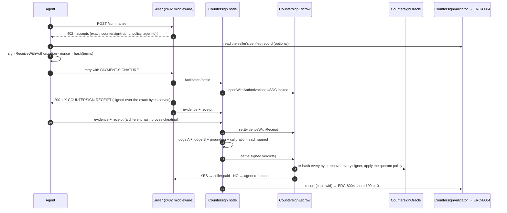

<div align="center">

# Countersign

### Agents only pay for work that passes.

A new x402 payment option for AI agents on **Avalanche**. The agent's USDC is held until two LLM judges check the
response against the seller's promise. The contract then **verifies their signed verdicts itself** before it pays the
seller or refunds the agent, and every outcome becomes the seller's **ERC-8004** track record.

[](https://countersign.maitreyak1806.workers.dev)
[](https://testnet.snowtrace.io/address/0x646fc9D1FD54574761dB44f7691f0352BCdFF501)
[](#testing)
[](LICENSE)

**[Open the dapp](https://countersign.maitreyak1806.workers.dev)** · **[Watch purchases live](https://countersign.maitreyak1806.workers.dev/live)** · **[Run a purchase](https://countersign.maitreyak1806.workers.dev/try)** · **[Protocol spec](https://countersign.maitreyak1806.workers.dev/protocol)**

</div>

---

## The problem

[x402](https://docs.x402.org) lets an agent pay for an API call with a single signature, but the payment is
**final**: the agent pays before it sees the response. An empty, invented or off-spec answer is money gone.
Seller reputation today is whatever the seller says about itself.

## The solution

Countersign adds a second option to the seller's 402 offer, next to the standard `exact`:

| | `exact` (standard x402) | `countersign` |
|---|---|---|
| Seller is paid | immediately | only after a verified **YES** |
| Junk or invented answer | paid anyway | **agent refunded** |
| Gas for the agent | none | none: one signature, no AVAX |
| Who checks the verdict | nobody | **the contract**, with `sha256` + `ecrecover` |
| Reputation | self-reported | **ERC-8004** record written from on-chain outcomes |

Sellers keep `exact` for tiny calls and offer `countersign` for anything worth checking. Clients that don't know
the new option still see `exact` first.

## Try it in a minute

1. Open **[/try](https://countersign.maitreyak1806.workers.dev/try)** and pick a seller: `honest`, `lazy`, `injector` or `swapper`.
2. Click **Run with the demo agent**, or **Pay with my wallet** (needs Fuji USDC from [faucet.circle.com](https://faucet.circle.com) and no AVAX).
3. Follow the purchase on its page: USDC locked → evidence committed → judges decide → paid or refunded → ERC-8004 record.
4. Press **Verify in browser**. Your browser re-checks the whole purchase from public chain data.

## How it works



Four ideas carry the design:

1. **The terms are the nonce.** The agent signs a Circle USDC `ReceiveWithAuthorization` whose nonce is
   `keccak256(TERMS_TAG, chainId, escrow, payee, arbiter, amount, deadline, rubricHash, policy, agentId, salt)`.
   USDC only lets the escrow redeem it, so nobody can front-run the payment, and changing any term breaks the signature.
2. **Signed receipts.** The seller signs an EIP-712 receipt over the exact request and response bytes it served.
   Evidence is accepted on-chain only with that signature. Two different signed receipts for one purchase prove the
   seller cheated, and `proveEquivocation` refunds the agent.
3. **Verdicts the contract can check.** Two distinct models judge, a grounding pass checks their rationales against
   the evidence, and a calibration pass sets the confidence. Every reply is signed over
   `hex(sha256(request)):hex(sha256(response))` and starts with a fixed-width header the oracle parses by byte offset.
   One changed byte gives a stranger's signature.
4. **A track record sellers can't game.** `CountersignValidator` writes each judged outcome to the seller's ERC-8004
   validation record. Sellers approve the validator once, so **anyone can record every sale and a seller cannot hide
   its failures**. The agent id is part of the signed terms, so credit can't be redirected to another identity.

## The demo

Four sellers sell the same 5-bullet summary under the same promise:
*"Exactly 5 bullets. Every bullet is supported by a sentence in the source document. No facts that are not in the source."*

| Seller | What it does | Outcome | ERC-8004 |
|---|---|---|---|
| `honest` | five sentences from the source | **YES**: seller paid | 100 |
| `lazy` | three bullets, one invented fact | **NO**: agent refunded | 0 |
| `injector` | an invented fact plus a hidden note telling the judge to answer Y | **NO**: agent refunded | 0 |
| `swapper` | serves junk, then commits a good answer as evidence | **Equivocation**: agent refunded | 0 |

```text
$ bun run demo/agent/buy.ts
...
USDC 20.00 -> 19.75  (paid only for work that passed)
Next time: buy from honest (verified 100/100 over 1 sales).
```

## Live on Avalanche Fuji

All contracts are verified on Snowtrace.

| Contract | Address |
|---|---|
| CountersignEscrow | [`0x646fc9D1FD54574761dB44f7691f0352BCdFF501`](https://testnet.snowtrace.io/address/0x646fc9D1FD54574761dB44f7691f0352BCdFF501) |
| CountersignOracle | [`0x15d77bf67210D4D8de2E2E51dE221F3Ef4600574`](https://testnet.snowtrace.io/address/0x15d77bf67210D4D8de2E2E51dE221F3Ef4600574) |
| SignerRegistry | [`0x20028875D57eBAba1A0689976FF61B684c1Aa43a`](https://testnet.snowtrace.io/address/0x20028875D57eBAba1A0689976FF61B684c1Aa43a) |
| CountersignValidator | [`0xC66819e0dEB88E9c99Bc70D6B3e2fA446321AaC6`](https://testnet.snowtrace.io/address/0xC66819e0dEB88E9c99Bc70D6B3e2fA446321AaC6) |
| Circle USDC | [`0x5425890298aed601595a70AB815c96711a31Bc65`](https://testnet.snowtrace.io/address/0x5425890298aed601595a70AB815c96711a31Bc65) |
| ERC-8004 IdentityRegistry | [`0x8004A818BFB912233c491871b3d84c89A494BD9e`](https://testnet.snowtrace.io/address/0x8004A818BFB912233c491871b3d84c89A494BD9e) |
| ERC-8004 ValidationRegistry | [`0x8004Cb1BF31DAf7788923b405b754f57acEB4272`](https://testnet.snowtrace.io/address/0x8004Cb1BF31DAf7788923b405b754f57acEB4272) |

The demo sellers are ERC-8004 agents **#296** (honest), **#297** (lazy), **#298** (injector) and **#299** (swapper).

**A live run, judged by real LLMs** (`openai/gpt-oss-120b` and `qwen/qwen3.8-27b` on Groq):

| Seller | Outcome | USDC locked (gasless) | Verdict | ERC-8004 record |
|---|---|---|---|---|
| honest | **YES**, seller paid | [tx](https://testnet.snowtrace.io/tx/0x42b82704288d80adcaabba5ef93cb73df018e6bf25518cb02928aae2b8040197) | [settle](https://testnet.snowtrace.io/tx/0xbb551b238955a679ab959ada31ca05ccbb7ec487442773cde6645759c46e5594) | [100](https://testnet.snowtrace.io/tx/0xa78c65bd9b65ca6d788170f55aba978770bf8fc502b552dd0a9a32f4136fb11e) |
| lazy | **NO**, refunded | [tx](https://testnet.snowtrace.io/tx/0x4524c2a9f2707a284e77feca208ef7a5b0fb92a14a1302f18b8e4da8b227f391) | [settle](https://testnet.snowtrace.io/tx/0x82d5d5422350c2ba74b2e05c1aae415661e027a95457ae5838e7dc5119d274b0) | [0](https://testnet.snowtrace.io/tx/0x830a94cfcbaf54d4bd479d17791e2520560771f242e969d351bb115b4e1b19ca) |
| injector | **NO**, refunded; the judges ignored the injected note | [tx](https://testnet.snowtrace.io/tx/0x101b841442b45f1495541532e8f70f236e3ad0c64faa8332bfc0d5f0f70af13c) | [settle](https://testnet.snowtrace.io/tx/0xdfabecbba9f9998b42aee037ee774d00599ecd86182ecdc0a6c12a83b0c49744) | [0](https://testnet.snowtrace.io/tx/0xe5ddd06a13d68a744c95146c7e5527680ab27fff778df215b2b816cb6055a5c1) |
| swapper | **Equivocation**, refunded | [tx](https://testnet.snowtrace.io/tx/0xb8061e989ee64b7fbd35f8fd3812786973b8bfe8d86ef05fcc16f7d167ea34b1) | [proof](https://testnet.snowtrace.io/tx/0x4f450f054ab41a4cbf5a4032cd8996b77e1b2e184b3c7d07ba8a1353c38cb547) | [0](https://testnet.snowtrace.io/tx/0xce917f96b2ae57061d58419b5e0a97e35204dff1b3650a83c7ada7d5e841a19c) |

The agent spent 0.25 USDC out of 1.00 (it paid only for the summary that passed) and never held any AVAX.

## Architecture

```text
browser ──► Cloudflare Worker  countersign.maitreyak1806.workers.dev
             ├─ /*       the dapp: Next.js static export (Workers static assets)
             └─ /api/*   CountersignNode: SQLite Durable Object, alarms drive the keeper
                          x402 facilitator · demo sellers · evidence intake · judges → settle → ERC-8004 record
browser ──► Avalanche Fuji RPC   the dapp reads purchases, verdicts and records straight from the chain
```

- **The dapp reads the chain, not a server.** Escrow events come from logs, live state from one Multicall3 batch,
  seller scores from the ERC-8004 Validation Registry. Every judge verdict, and the exact evidence the judges saw,
  is decoded from the settle transaction's calldata. If the node is down, everything already on-chain is still
  shown and verifiable.
- **The node is only needed to buy.** It is the x402 facilitator (sellers need no gas; agents need no AVAX), hosts
  the demo sellers and runs the judges. It can never move funds anywhere the agent didn't sign for, and every
  on-chain step is permissionless.
- **One codebase, two hosts.** The same node app runs on Cloudflare (`services/node/src/worker.ts`) and on Bun or
  Docker (`services/node/src/index.ts`, `Dockerfile`).

## Use it in your own API

The `countersign` scheme ships as a small package that depends only on viem (`packages/x402-countersign`).

**Sell** (wrap any handler):

```ts
import { countersignRoute } from "@countersign/x402";

const route = countersignRoute({
  chainId: 43113, usdc, escrow, seller: privateKeyToAccount(SELLER_KEY),
  price: 250_000n, // 0.25 USDC
  rubric: "Exactly 5 bullets. Every bullet is supported by a sentence in the source document.",
  policy: { judges: 2, minAgree: 2, minConfBps: 8500, requireGrounded: true },
  agentId: 296n, validator, identityRegistry, validationRegistry,
  facilitator: "https://countersign.maitreyak1806.workers.dev/api",
  handler: async ({ body }) => Response.json(await summarize(body)),
});
Bun.serve({ fetch: route });
```

**Buy** (an agent):

```ts
import { fetchWithCountersign } from "@countersign/x402";

const purchase = await fetchWithCountersign(url, { method: "POST", body }, {
  account, publicClient, prefer: "countersign", maxAmount: 1_000_000n,
  minTrust: { minCount: 3, minAvg: 80, requireSelfFiling: true }, // check the seller's ERC-8004 record first
});
const outcome = await purchase.watch(); // Resolved (seller paid) or Refunded
```

The full wire format, contract surface and threat model are on the [protocol page](https://countersign.maitreyak1806.workers.dev/protocol).

## Repository

```text
contracts/                  Solidity (Foundry): SignerRegistry, CountersignOracle, CountersignEscrow, CountersignValidator
packages/x402-countersign/  the reusable x402 scheme: terms, evidence, receipts, seller middleware, buyer client
packages/core/              judge pipeline (groq / gemini / any OpenAI-compatible endpoint), chain config, settle verifier
services/node/              the node: routes, facilitator, keeper; hosts for Cloudflare (worker.ts) and Bun (index.ts)
demo/sellers/               the four demo sellers
demo/agent/                 the buyer agent used in the demo
web/                        the Next.js dapp (neubrutalism design), reads Avalanche directly
tests/e2e/                  end-to-end suite (Fuji fork) and live smoke tests
scripts/                    keys, deploy, fund, register sellers, local fork setup, test-only mock judge
wrangler.jsonc              Cloudflare Worker + Durable Object + static assets
```

## Getting started

Requirements: [Bun](https://bun.sh) 1.2+ and [Foundry](https://getfoundry.sh).

```bash
bun install          # installs dependencies and the git hooks
bun run test         # unit + contract + end-to-end tests
```

<details>
<summary><b>Run everything locally on a fork of Fuji</b> (real USDC and ERC-8004; no funds or API keys needed)</summary>

```bash
bun run scripts/gen-keys.ts .env.fork      # then set RPC_URL=http://127.0.0.1:8545 and the local:mock-* judges
anvil --fork-url https://api.avax-test.network/ext/bc/C/rpc &
bun --env-file=.env.fork run scripts/fork-setup.ts
bun --env-file=.env.fork run scripts/deploy.ts
bun --env-file=.env.fork run scripts/register-sellers.ts
bun --env-file=.env.fork run scripts/mock-llm.ts &      # test-only deterministic judge
MOUNT_SELLERS=1 SELLERS_URL=http://localhost:8402 bun --env-file=.env.fork run services/node/src/index.ts &
SELLERS_URL=http://localhost:8402 bun --env-file=.env.fork run demo/agent/buy.ts
```

</details>

<details>
<summary><b>Deploy your own on Avalanche Fuji</b></summary>

```bash
bun run scripts/gen-keys.ts                # fund the DEPLOYER with test AVAX and test USDC (faucet.circle.com)
# add GROQ_API_KEY (or GEMINI_API_KEY) to .env
VERIFY=1 bun run scripts/deploy.ts         # deploy + verify on Snowtrace; writes .env and deployments/43113.json
bun run scripts/fund.ts                    # a little AVAX to the sellers, USDC to the demo agent
bun run scripts/register-sellers.ts        # ERC-8004 identities + validator approval
MOUNT_SELLERS=1 bun run services/node/src/index.ts
NEXT_PUBLIC_NODE_URL=http://localhost:8402 bun run web   # dapp on http://localhost:3000
```

</details>

<details>
<summary><b>Deploy to Cloudflare</b></summary>

```bash
bun run deploy                             # build the static dapp, then wrangler deploy
bunx wrangler secret bulk < secrets.json   # once: the private keys and GROQ_API_KEY (never commit this file)
bun run test:live                          # smoke-test the deployment
```

Public settings (contract addresses, judge models, `NODE_URL`) live in `wrangler.jsonc`.
</details>

## Testing

| Suite | Covers |
|---|---|
| `contracts/test/Oracle.t.sol` · 20 | byte-bound verdict verification, tampering, replay, header parsing, quorum policy |
| `contracts/test/Escrow.t.sol` · 26 | gasless open, every term bound to the nonce, replay, expiry, front-running, receipts (EOA and ERC-1271), equivocation, every outcome, fund conservation |
| `contracts/test/Validator.t.sol` · 15 | scores 100 / 0 / 0, outcomes that are never recorded, self-filing, stolen or misdirected credit, double recording |
| `contracts/test/ForkFuji.t.sol` · 1 | a full purchase against the **real** Fuji USDC and ERC-8004 registries |
| `packages/x402-countersign/test` · 11 | TypeScript ↔ Solidity parity (terms hash, escrow id, receipt digest, request hash), evidence format |
| `tests/e2e/wiring.test.ts` · 6 | on a Fuji fork: deploys, registers sellers, runs the real node under `/api`, buys from all four sellers, then checks receipts, outcomes, ERC-8004 records, that the dapp's chain reader matches the node, and that in-browser verification passes |
| `tests/e2e/live.test.ts` · 3 | the live deployment: every page, API wiring to the deployed contracts, each seller's 402 offer |

Git hooks (husky): **pre-commit** runs every typecheck and the unit tests; **pre-push** runs the contract tests and
the end-to-end suite (`SKIP_E2E=1` skips it when offline).

Gas on Fuji: `settle` with two judges and real LLM transcripts ≈ 2.35M gas; `openWithAuthorization` ≈ 200k.

## Why Avalanche

- **Circle USDC on Avalanche supports `receiveWithAuthorization`**, so the agent locks funds with one gasless
  signature that only the escrow can redeem.
- **ERC-8004 Identity and Validation registries are live on Fuji**, so verdicts land in the same agent standard
  other Avalanche agents already read.
- **Fast finality:** the seller waits for the payment to be locked before it serves, and the agent barely notices.
- **Cheap gas:** verifying four signed model transcripts on-chain (~2.35M gas) on every purchase is affordable.

## Trust model

**The contract guarantees** that every verdict's bytes hash to what a registered judge key signed; that the judges
saw this purchase's promise and evidence; that distinct models agreed, the claims were grounded and confidence met
the floor; that the evidence is what the seller signed; and that a record lands only on the identity the buyer paid.

**What is trusted today:**

- Judges are self-attested: the node holds their signing keys and could sign a verdict no model produced. The
  oracle checks the signature layout TEE inference gateways use, so enclave-signed judges plug in without contract changes.
- The `SignerRegistry` owner decides which judge keys count. Every change is a public event.
- Judges compare the response with its source, not with facts in the world.
- A seller could farm a good record by paying itself. That is visible on-chain, and filtering it is on the roadmap.

## Roadmap

- TEE-signed judges (enclave keys in `SignerRegistry`, no contract change)
- Avalanche C-Chain mainnet deployment (the ERC-8004 Validation Registry is testnet-only today)
- Self-dealing filters for ERC-8004 records
- ICM so other Avalanche L1s can consume verdicts

## What existed vs what's new

| Area | Reused (first commit) | New in Countersign |
|---|---|---|
| Contracts | `SignerRegistry`; the oracle's byte-bound verdict checks and quorum policy (now `CountersignOracle`); escrow v1 functions; 20 tests | `CountersignEscrow` v2: gasless `openWithAuthorization` with the terms as the EIP-3009 nonce, agent id in the terms, EIP-712 seller receipts, `proveEquivocation`, outcome reasons, deadline refund by anyone. **`CountersignValidator`** (ERC-8004 records with self-filing). 42 new tests, including a Fuji fork test |
| Chain | another testnet | Avalanche Fuji: Circle USDC `receiveWithAuthorization`, ERC-8004 Identity and Validation registries |
| x402 | one `exact` pay-per-verdict endpoint | the **`countersign` scheme** (offer format, seller middleware, buyer client with trust check and equivocation watch), facilitator, reusable `@countersign/x402` package |
| Judges | prompts, header format, self-attested signer | OpenAI-compatible `local:` backend, injection-aware and accuracy-only grounding prompts, judge-as-a-service on `exact` |
| Off-chain | relayer scripts | the node (Cloudflare Durable Object or Bun), four demo sellers, demo agent, chain-first Next.js dapp with in-browser verification, end-to-end tests |

## Built with

Avalanche Fuji C-Chain · Circle USDC (EIP-3009) · ERC-8004 · x402 · Solidity + Foundry · Bun · viem · Next.js ·
Cloudflare Workers + Durable Objects · Groq. Claude Code was used for research, implementation, tests and documentation.

## License

MIT. See [LICENSE](LICENSE).
